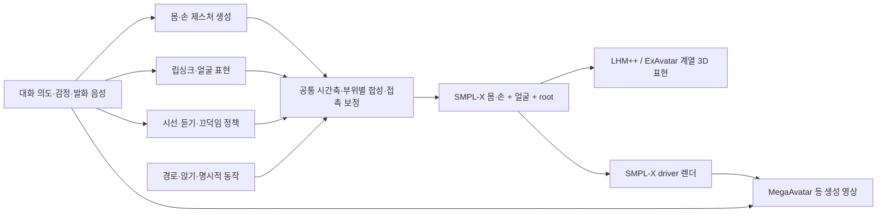

# 전신 대화 아바타 기술 검토 — Ditto / LAM 이후

> **우선순위 수정:** 사용자는 표정·눈·고개 제어를 핵심으로 명확히 했고, 몸은 반복 모션으로 충분하다고 했다. 아래 전신 생성 우선순위보다 [공감 비언어행동 중심 재검토](empathic-nonverbal-control-review-20261028.md)의 추천을 적용한다. 본문은 전신 기술 비교 자료로 유지한다.

검토일: **2026-10-28**. 대상: 현재 EmpathicGenAvatar 코드, 저자 논문·프로젝트·공식 저장소·가중치 목록. 장비: 현재 호스트에서 확인한 **RTX 5090, 32GB VRAM**. 아래 외부 성능은 저자 보고이며 이 장비에서 재현한 수치가 아니다. 이번 작업은 조사와 설계 검토다. 신규 후보 모델의 설치·추론·품질 비교는 수행하지 않았다.

## 1. 의사결정 요약

**얼굴 표정·머리·손·몸을 하나의 아바타에서 제어하는 기술은 이미 있다.** ExAvatar와 TaoAvatar는 전신 3DGS 계열의 실례다. MegaAvatar는 참조 이미지·음성·SMPL-X 몸동작을 함께 받아 영상을 생성한다. 따라서 “전신 원큐 기술은 없다”는 결론은 부정확하다. 다만 **사진 한 장, 정밀한 부위별 제어, 저지연 양방향 대화, 단일 5090, 브라우저 구동, 배포 가능한 공개 자산**을 모두 충족한다고 검증된 단일 제품은 이번 조사에서 확인하지 못했다. [ExAvatar](https://mks0601.github.io/ExAvatar/), [TaoAvatar](https://pixelai-team.github.io/TaoAvatar/), [MegaAvatar](https://github.com/Jeoyal/MegaAvatar)

추천은 다음과 같다. 순위는 실측 화질 순위가 아니라 **우리 목표에 대한 실험 우선순위**다.

| 목적 | 첫 비교 대상 | 선정 이유 | 바로 해결되지 않는 것 |
|---|---|---|---|
| 생성한 가상 인물 → 제어 가능한 전신 | **LHM++** | 한 장/여러 장에서 전신 생성, 공개 기본 가중치, SMPL-X·표정 입력 경로 | 얼굴·구강 품질, 동적 옷, 웹 배포, 라이선스 |
| 실제 인물의 촬영 자료 → 전신 | **ExAvatar** | 몸·손·얼굴을 한 구조에서 구동하는 공개 개인화 파이프라인 | 촬영·피팅·학습 비용, 단일 사진만으로의 재현 |
| 지정한 몸동작+음성 → 자연스러운 영상 | **MegaAvatar** | SMPL-X 동작 조건과 오디오 조건을 함께 제공 | 스트리밍 지연, 임의 표정 계수 직접 제어, 32GB 적합성 |
| 5090 한 장에서 가벼운 생성 영상 비교 | **EchoMimicV3-Flash** | 공개 1.3B, 저자 12GB 실행 안내 | 정확한 관절 제어, 실제 대화 지연 |
| 현재 Ditto 얼굴 영상 개선 | **SoulX-FlashHead Lite** | 공개 스트리밍 구현, 소비자 GPU 속도 근거 | 전신 제어 |
| LAM 얼굴 자산 개선 | **FastAvatar / FlexAvatar** | 최신 공개 얼굴 재구성 비교군 | 전신으로 확장되는 것은 아님 |

**주력 제안:** 전신 3DGS/하이브리드 자산 + 공통 동작 타임라인을 먼저 검증한다. 동일한 타임라인을 생성 영상 경로에도 공급해 비교한다. 실시간 대화는 조작·중단·시점 변경이 가능한 3D 경로를 우선하고, 생성 영상은 화질 우선 경로로 검증한다. 이는 공개 기능과 현재 제약에 근거한 설계 판단이며 특정 모델의 우월성을 실측한 결론은 아니다.

## 2. 현재 코드에서 전신까지 남은 간격

| 현재 구현 | 확인한 상태 | 전신 목표에 대한 의미 |
|---|---|---|
| Ditto | Default는 완성된 TTS WAV, Realtime은 청크 입력/25fps PTS. 표정 프리셋·제한된 머리 움직임. 시선은 독립 눈동자 제어 대신 작은 머리 단서 | 얼굴 영상 어댑터다. 전신 관절을 추가 전달한다고 몸을 생성하는 모델로 바뀌지 않는다 |
| LAM | FLAME 기반 얼굴 생성. 내보내기는 개인별 기본 위치와 템플릿 morph/skin/skeleton을 결합 | 얼굴 외형 개인화와 개인별 동적 변형 학습이 다르다. 전신 골격·손·발이 없다 |
| MotionFrame | `turn_id`, `pts_ms`, 얼굴 weights, head, gaze, behavior | 몸 관절, 손, root 이동, 발 접촉, 리그 버전이 아직 없다 |
| A2F + behavior | 발화 얼굴 동작과 감정·시선·고개 정책의 소유권을 분리하고 오디오 시계 사용 | 이 분리와 시간 관리는 전신으로 확장할 기반이다 |
| 기존 구강/눈 비교 | 9월 기록에 무보정 LAM의 구강 외형 한계와 웹 눈 가림 실패가 남아 있음 | 전신을 추가해도 얼굴 품질은 별도 합격 기준이 필요하다 |
| CAP4D | 환경·가중치·5090 CUDA 커널 검증은 완료. 지정 FLAME 파일/추적 준비 미완료로 전체 생성은 미완료 | CAP4D가 이미 개선 결과를 냈다고 간주하지 않는다. 전신의 직접 해결책도 아니다 |

근거: [avatar worker](../workers/avatar/README.md), [MotionFrame](../apps/web/src/gaussian/types.ts), [export_asset](../workers/gaussian/export_asset.py), [behavior 합성](../apps/api/app/gaussian_behavior.py), [LAM 기준/CAP4D 실행 기록](gaussian-baseline-cap4d-execution-20260929.md).

9월 검토는 얼굴 품질 중심이었다. 이번에는 목표가 전신이므로 **CAP4D를 전체 프로젝트의 첫 실험으로 두는 우선순위를 변경**한다. CAP4D/FastAvatar/FlexAvatar는 얼굴 개선 트랙에 두고, 전신 재구성·모션·렌더링을 먼저 검증한다.

## 3. “원큐”의 세 의미

| 의미 | 존재 여부 | 예시와 경계 |
|---|---|---|
| 하나의 3D 자산으로 얼굴·머리·손·몸을 제어 | **있음** | ExAvatar, TaoAvatar. 외부 모션/음성 드라이버는 별도일 수 있음 |
| 사진+음성+몸동작을 입력해 최종 전신 영상을 생성 | **있음** | MegaAvatar. 영상 출력이며 관절 값을 정확히 보존하거나 실시간임을 자동 보장하지 않음 |
| 사진 한 장부터 듣기·말하기·감정·손짓·걷기·접촉까지 한 모델로, 단일 5090 실시간 | **이번 조사에서 검증된 공개 완제품 미확인** | 얼굴 애니메이션, co-speech 제스처, 보행/접촉, 외형 재구성은 서로 다른 문제 |

SMPL-X는 몸·손·표정을 함께 표현하는 **제어 모델**이다. 그 자체가 사실적인 인물 외형, 치아, 옷, 음성 기반 행동을 완성하는 생성 모델은 아니다. 또한 “전신 프레임에 사람이 보인다”, “음성에 맞춰 몸이 움직인다”, “오른손을 지정한 위치에 놓고 걸으면서 표정도 바꿀 수 있다”는 각각 다른 기능이다. [SMPL-X 공식 설명](https://smpl-x.is.tue.mpg.de/)

## 4. 생성 영상 후보

| 후보 / 공개 근거 | 실제 입력과 장점 | 현재 적용 판단 |
|---|---|---|
| **MegaAvatar**, 2026-09. [논문](https://arxiv.org/abs/2609.39273), [코드](https://github.com/Jeoyal/MegaAvatar), [가중치](https://huggingface.co/Gaojunyao/MegaAvatar) | Wan2.2-TI2V-5B 기반. 참조 이미지로 외형, SMPL-X 렌더 프레임으로 몸/머리, 음성으로 입 동작. 드라이버가 없으면 GestureLSM으로 생성 | **명시적인 전신 동작 조건이 필요한 영상 실험 1순위.** 기본 예제는 50 steps와 4 GPU 인자. 이것을 최소 GPU 수로 단정할 수는 없지만 단일 5090 실시간 근거도 없음. 얼굴 identity 유지와 원하는 표정의 독립 제어는 구분 |
| **EchoMimicV3-Flash**, 2026-01 업데이트. [공식 저장소](https://github.com/antgroup/echomimic_v3) | 1.3B, 이미지·음성·텍스트 조건의 human animation. Flash는 저자 기준 8 steps, 12GB VRAM, 최대 768² 안내 | **5090에서 먼저 돌릴 수 있는 생성 영상 비교군.** 표정/몸 자연스러움과 한국어 립싱크 평가. Flash라는 이름만으로 실시간이나 정확한 손·발 좌표 제어를 가정하지 않음 |
| **Wan-Animate-2**, 2026-08. [저장소](https://github.com/Wan-Video/Wan-Animate-2), [프로젝트](https://humanaigc.github.io/wan-animate-2) | 참조 이미지와 driving video에서 얼굴·몸 동작을 함께 전이. 시점 조건도 제공 | 얼굴/몸 전이 품질 비교군. 공개 Base/Distillation과 소개된 Lite를 혼동하지 않음. 공식 720p 예제 8×A800, 시험된 480p 예제 2×A800. 음성만 넣는 현재 Ditto 인터페이스의 직접 대체품은 아님 |
| **LongCat-Video-Avatar 1.5**, 2026-05. [저장소](https://github.com/meituan-longcat/LongCat-Video), [모델](https://huggingface.co/meituan-longcat/LongCat-Video-Avatar-1.5) | 이미지+음성+텍스트, 긴 영상 연장, 다인물, 8-step 증류/INT8 경로 | 몸과 배경을 포함한 고품질 발화 영상 비교군. 공식 다중 GPU 실행 예제와 구체 관절 제어 부재를 감안하면 즉시 저지연 기본 경로로 선정하지 않음 |
| **SoulX-FlashHead Lite / Pro**, 2026-02. [공식 저장소](https://github.com/Soul-AILab/SoulX-FlashHead) | Lite 저자 4090 96fps 또는 3동시 세션 25+fps. Pro는 4090 10.8fps, 2×5090 실시간 안내. 스트리밍 코드 공개 | **Ditto 대체 A/B 1순위는 Lite.** Pro의 품질과 Lite의 속도를 같은 모델의 성능처럼 합치지 않음. 얼굴 중심이라 전신 목표를 완성하지 못함 |
| **AVTR-1**, 2026-09. [논문](https://arxiv.org/abs/2609.22913), [코드](https://github.com/avaturn-live/avtr-1) | 사용자/에이전트 양쪽 음성을 받아 듣기·발화 얼굴 행동. 경량 모션 모델과 LivePortrait 계열 렌더러 | 공감형 대화의 **듣는 행동** 참고 가치. 전신 모델 아님. 모델·renderer·streamer의 라이선스가 서로 다르므로 통합 채택 조건 확인 필요 |

### 실시간 발표를 읽을 때의 GPU 조건

| 후보 | 저자가 제시한 조건 | 우리 장비에서의 해석 |
|---|---|---|
| [StreamAvatar, CVPR 2026](https://streamavatar.github.io/) | 928×704, 25fps, 2×H800. 입력 축적을 포함한 전체 지연 1.20초 | 말하기/듣기와 몸짓을 함께 다루는 방향은 적합. 공식 페이지에서 바로 사용할 코드·가중치 경로는 확인하지 못함 |
| [LiveAvatar](https://github.com/Alibaba-Quark/LiveAvatar) | 14B, 다중 H800의 파이프라인으로 실시간. FP8 48GB, 단일 80GB offline 경로 안내 | 긴 실시간 영상이 가능하다는 근거지만 32GB 5090 한 장의 동작 보장은 아님 |
| [SoulX-FlashTalk](https://github.com/Soul-AILab/SoulX-FlashTalk) | 14B, 기본 실시간 예제 8×H800. 단일 GPU는 64GB 초과 또는 offload 시 40GB 안내 | 현재 장비의 첫 도입 대상보다 서버 예산을 늘렸을 때의 후보 |
| [Maya-2, 2026-10](https://www.thriftyai.com/research/maya-2) | 벤더 발표 32fps, 약 0.90초 지연, 8 GPU 노드 | 최신 상용 기술의 참고선. 공개 가중치 및 임의 관절 제어 인터페이스는 확인하지 못함 |

위 모델들의 FPS는 서로 다른 해상도·GPU·청크·precision·동시 세션 조건이다. 같은 표에 숫자만 정렬해 우승 모델을 선정하지 않는다. 특히 평균 생성 FPS가 충분해도 첫 응답, 청크 축적, 디코딩, 네트워크, 플레이아웃 버퍼에서 지연이 생긴다.

## 5. 전신 3DGS / 하이브리드 후보

| 후보 | 생성 입력 / 제어 범위 | 공개 상태와 적용 판단 |
|---|---|---|
| **LHM++**, 2026 공개 업데이트. [논문](https://arxiv.org/abs/2506.13766), [코드](https://github.com/aigc3d/LHM-plusplus) | 한 장 또는 pose-free 여러 장 → 전신 아바타. 코드에 body, jaw, 양손, expression 입력 존재 | 기본 LHMPP-700M 가중치 확인. **현재 가상 인물 전신의 첫 native 비교 대상.** 얼굴 미세 표정·구강·옷 품질과 웹 호환성은 별도 검증 |
| **ExAvatar**, ECCV 2024. [프로젝트](https://mks0601.github.io/ExAvatar/), [공개 재구현](https://github.com/mks0601/ExAvatar_RELEASE) | 단안 촬영 영상에서 개인화, SMPL-X와 Gaussian 연결로 몸·손·얼굴 동시 제어 | 피팅/학습/추론 경로 공개. **실촬영 확보 시 가장 유용한 재현 기준.** 한 장 가상 인물에서 바로 완성되는 범용 모델은 아님 |
| **TaoAvatar**, CVPR 2025. [프로젝트](https://pixelai-team.github.io/TaoAvatar/) | 다중 시점 개인화, 옷을 확장한 SMPL-X와 Gaussian, 변형 증류 | 전신 표정·제스처와 Vision Pro 90fps 렌더링을 시연. 데이터/모바일 데모 링크 확인. 신규 인물의 완전한 공개 학습 체인은 미확인. 촬영 비용이 높아 장기 품질 목표에 적합 |
| **DynaAvatar**, CVPR 2026. [프로젝트](https://juhyeon-kwon.github.io/DynaAvatar.github.io/), [코드](https://github.com/juhyeon-kwon/DynaAvatar_RELEASE) | 한 장 → 전신; LHM 기반, 과거 모션을 이용한 의복 동적 변형 | 코드/학습/가중치 안내 공개. **옷의 자연스러움 개선 연구 후보.** 매 프레임 변형 신경망 비용이 있어 실시간으로 바로 선정할 수 없고 얼굴 품질 개선도 별도 |
| **F3G-Avatar**, CVPRW 2026. [코드](https://github.com/wjmenu/F3G-avatar), [논문](https://arxiv.org/abs/2604.09835) | 보정된 다중 카메라·옷 포함 템플릿; 얼굴 crop을 별도로 강화하는 전신 재구성 | 코드/모델 안내 공개. 얼굴 세부가 중요한 전신 학습 설계 참고. 사진 한 장 대체 경로는 아님 |
| **OneShotOneTalk**, ICCV 2025. [프로젝트](https://ustc3dv.github.io/OneShotOneTalk/) | 한 장에서 몸/얼굴 pseudo-video를 만들고 mesh-Gaussian 아바타 학습 | 요청과 매우 가까운 방향. 공식 페이지의 Code coming soon 상태를 확인해 즉시 적용 후보에서는 보류 |
| **AudioAvatar**, CVPR 2026. [공식 논문 초록](https://openaccess.thecvf.com/content/CVPR2026/html/Lee_AudioAvatar_Personalized_Audio-driven_Whole-body_Talking_Avatars_CVPR_2026_paper.html) | 이미지·음성으로 몸·손·얼굴 Gaussian 동작을 직접 예측하는 개인화 모델 | “음성부터 전신까지”의 직접 연구 사례. 확인한 공식 경로에서는 실행 코드/가중치·5090 지연·수동 제어 범위를 검증하지 못함 |

### LHM++를 추천하면서도 즉시 웹 교체를 약속하지 않는 이유

1. README의 약 **8GB / 한 뷰 0.79초**는 저자 재구성 조건이다. 전처리·매 프레임 애니메이션·신경 보정·웹 전송까지 포함한 지연이 아니다.
2. 공개 기본 `LHMPP-700M`은 Gaussian 뒤의 **neural refinement**를 사용하는 경로다. 현재 코드의 `GS_RENDER_SUPPORTED_MODEL_NAMES`는 `PixelShuffle`, `SMPLX-FREE` 두 변종만 지정한다. README의 “updated 700M PLY 지원” 문장만 보고 기본 모델의 pure-GS 지원을 확정하면 안 된다.
3. 기본 가중치 파일은 확인했다. PixelShuffle은 README에 hub pending, 두 GS 변종의 Hugging Face 조회는 401이었다. 401만으로 미출시·비공개·접근 제한 중 어느 것인지는 확정할 수 없다. 우선 확보 가능한 기본 모델로 native 검증한다.
4. `to_gs_ply.py`는 canonical 또는 **단일 posed frame**을 저장한다. 관절/skin weight/표정 basis를 포함한 브라우저 애니메이션 패키지를 자동으로 제공하는 것이 아니다.
5. 기존 LAM ZIP의 `skin.glb`, `offset.ply`, morph, vertex 순서 규약과 호환되지 않는다. 별도 어댑터·변형 실행·공동 렌더링을 구현해야 한다.
6. 참조 설치 환경은 CUDA 12.1/PyTorch 2.3이다. 기존 5090 환경으로 CUDA 확장들을 빌드하는 별도 호환성 검증이 필요하다.

근거: [README](https://github.com/aigc3d/LHM-plusplus/blob/main/README.md), [모델 registry](https://github.com/aigc3d/LHM-plusplus/blob/906b5d9fb967ab42efb92f6fa55bf22cac86b653/core/utils/model_card.py), [제어 입력](https://github.com/aigc3d/LHM-plusplus/blob/906b5d9fb967ab42efb92f6fa55bf22cac86b653/core/models/rendering/base_gs_render.py), [PLY export](https://github.com/aigc3d/LHM-plusplus/blob/906b5d9fb967ab42efb92f6fa55bf22cac86b653/scripts/inference/to_gs_ply.py), [공개 기본 가중치](https://huggingface.co/3DAIGC/LHMPP-700M).

### 얼굴과 배포를 위한 보조 후보

| 후보 | 가치 | 범위/공개 제약 |
|---|---|---|
| [FastAvatar, ICLR 2026](https://github.com/TyrionWuYue/FastAvatar) | 단일/여러 관측의 빠른 얼굴 재구성, 학습 코드·가중치 공개 | 전신 아님. 입 안이 없는 관측으로 구강 문제가 완전히 해결된다고 가정하지 않음 |
| [FlexAvatar, CVPR 2026](https://github.com/tobias-kirschstein/flexavatar) | 단일/여러 이미지에서 제어 가능한 head avatar, 공개 FLEX1 경로 | 전신 아님. ARKit drop-in도 아님. CC-BY-NC 조건. 조회 README에 미래 날짜가 섞여 있어 그 항목을 현재 릴리스 근거로 사용하지 않음 |
| [FiCA, 2026-06](https://youwangk.github.io/FiCA) | 단일 사진 head 생성과 UV diffusion 기반 얼굴 표현 prior | 공식 페이지에서 실행용 릴리스 확인 못 함. 연구 관찰 대상 |
| [MeshLAM, CVPR 2026](https://meshlam.github.io/) | 가벼운 텍스처 mesh head로 표현 방식 전환 | 전신 아님. 프로젝트 Code 링크가 기존 LAM으로 연결되어 독립 체크포인트 출시를 확정하지 않음 |
| [GALA, 2026-10](https://ramazan793.github.io/gala/), [저장소](https://github.com/ramazan793/gala) | 무거운 Gaussian 변형을 공유 선형 basis+작은 MLP로 증류. DynaAvatar/FlexAvatar 등에 적용, 저자 모바일 웹 60fps 시연 | **재구성 모델이 아니라 배포 최적화 연구.** 저장소 Code coming soon. 공개 즉시 사용 가능한 변환기로 계획하지 않음 |

TaoAvatar와 GALA가 보여주는 공통 방향은 생성/개인화 단계의 무거운 학습과 실행 단계의 가벼운 변형을 나누는 것이다. 단, 빠른 rasterizer만으로 전체 아바타가 빨라지는 것은 아니다. 매 프레임 신경 변형까지 측정해야 한다.

## 6. 몸을 무엇으로 움직일 것인가

| 후보 | 제공하는 기능 | 우리 적용 |
|---|---|---|
| **GestureLSM**, ICCV 2025. [코드](https://github.com/andypinxinliu/GestureLSM), [논문](https://arxiv.org/abs/2501.18898) | 음성 조건의 몸·손 제스처, 빠른 생성. 공개 가중치, MegaAvatar의 audio→SMPL-X 경로에도 사용 | **실행 가능한 첫 모션 비교군.** 빠른 추론 수치와 causal streaming 지원을 구분. 창 길이·미래 음성 의존·연결부를 직접 측정 |
| **EMAGE**, CVPR 2024. [논문](https://arxiv.org/abs/2401.00374), [현재 저자 저장소](https://github.com/haiyangliu0/character-policy) | 몸·손·얼굴 holistic co-speech, SMPL-X pose/FLAME expression/root translation | 공개 비교 기준. holistic 출력 그대로와 A2F 입 모션을 적용한 경우를 각각 비교해 동기/자연스러움 손실 측정 |
| **LiveGesture**, CVPR 2026. [공식 페이지](https://m-usamasaleem.github.io/publication/LiveGesture/LiveGesture.html) | 미래 오디오를 보지 않는 causal 몸·얼굴 제스처. 저자 200ms 청크를 50ms 미만 연산 | 스트리밍 설계 참고. 청크 수집 시간은 존재하며 이번 공식 경로에서 즉시 쓸 코드/체크포인트 확인 못 함 |
| **GestureFAR**, 2026-09. [논문](https://arxiv.org/abs/2609.21576), [저장소](https://github.com/andypinxinliu/GestureFAR) | 연속 latent flow autoregression, token-causal streaming, one-step head distillation | 요청에 매우 가까운 최신 연구. 조회 시 공식 GitHub는 **empty repository**여서 구현 우선순위에서는 보류 |
| **Intentional-Gesture**. [논문](https://arxiv.org/abs/2505.15197), [저장소](https://github.com/andypinxinliu/Intentional-Gesture) | 의미·전달 의도를 고려한 제스처 | 공감 정책과의 접점. 조회 README가 제목만 있어 실행 가능 릴리스로 계산하지 않음 |
| **FloodDiffusion 2**, 2026-09. [논문](https://arxiv.org/abs/2609.33167), [코드](https://github.com/caiyy17/FloodDiffusion2) | 변하는 텍스트와 root 경로를 조건으로 지속적인 전신 모션. 코드·4개 checkpoint 안내, 저자 4090 추론 테스트 | **걷기/이동이 필요할 때 별도 후보.** speech lip-sync 모델이 아니며 SMPL-H/다른 skeleton 표현을 SMPL-X에 retarget해야 함. 텍스트 인코더·피팅·렌더 비용을 포함해 검증 |

BEAT/BEAT2 계열의 말할 때 손짓은 자유로운 보행·앉기·물체 잡기와 다르다. 첫 단계는 **서 있는 대화 또는 앉은 대화**로 고정한다. 이동을 넣을 때 locomotion/접촉 제약을 추가하고, 몸 전체를 두 모션 모델이 동시에 덮어쓰지 않게 한다.

## 7. 권장 조합과 자연스러움을 만드는 조건

### A. 실시간 전신의 첫 설계

**전신 외형:** 가상 인물은 LHM++, 촬영 인물은 ExAvatar로 같은 scripted SMPL-X 시퀀스를 구동한다. 처음에는 공식 native 렌더를 사용해 모델 품질과 웹 변환 문제를 분리한다. native가 느리면 server video/WebRTC도 공짜 해결책이 아니므로 실제 변형+렌더 비용을 먼저 확인한다.

**몸·손:** GestureLSM 또는 EMAGE를 비교한다. 바로 적용 가능한 짧은 사람 모션 클립 라이브러리를 저지연 fallback으로 유지한다. 대화 정책은 강조·가리키기·수긍·안정된 경청 등 의도를 선택하고 모션 모델/클립이 연속 궤적을 만든다.

**얼굴:** A2F가 입술·턱의 발화 동작을 소유하는 조합과 holistic 모델의 얼굴 출력을 그대로 쓰는 조합을 A/B 한다. “입은 A2F, 나머지는 임의 합산”은 충분하지 않다. 볼·입꼬리·턱이 발음과 표정에 함께 관여하므로 정점/리그 공간에서 부위별 가중 피팅과 유효 범위 제한이 필요하다.

**현재 51/52 ARKit 채널과 FLAME 계수는 인덱스 대응이 아니다.** 모델 버전, neutral, 표정 basis, jaw 정의를 고정하고 변환을 교정한다. EMAGE의 출력이 FLAME-native라는 이유만으로 LHM++의 FLAME 버전과 계수 의미가 자동 일치하지 않는다. 변환은 blink, jaw, smile, lip closure, 복합 표정으로 검증한다. [EMAGE 출력/변환 도구](https://github.com/haiyangliu0/character-policy), [FLAME 모델과 버전](https://flame.is.tue.mpg.de/)

### B. 반드시 하나로 합쳐야 하는 것

| 요소 | 구체적인 구현 원칙 | 없을 때 보이는 문제 |
|---|---|---|
| 시간 | PCM 샘플 수에 기반한 현재 `pts_ms` 유지. 오디오/얼굴/몸/생성 영상 모두 동일 시각을 참조 | 입과 손의 강세가 어긋남, 시간이 지날수록 drift |
| 머리/목 | body neck/head transform을 하나의 소유자가 결정. 얼굴 local pose로 변환 후 적용 | 고개 회전 두 번 적용, 목이 늘어나거나 얼굴이 떠다님 |
| 좌표/체형 | meter, up-axis, 회전 convention, skeleton/FLAME 버전 명시. 캐릭터 beta 고정 | 캐릭터 크기 변화, 팔 길이 변화, 발이 바닥 아래로 이동 |
| root/발 | 이동 궤적과 발 접촉 구간을 관리하고 IK·joint limit·충돌 보정 | 제자리 미끄러짐, 무게 중심 없이 걷기, 손이 몸 관통 |
| 몸의 연쇄 | 손만 올리지 않고 어깨·척추·목·시선이 같은 의도에 반응 | 손만 분리돼 움직이는 인상 |
| 중단/전환 | 현재 turn 취소, 발화 입 정지, 몸은 짧은 감속/전환 후 경청. 마지막 포즈에서 연속 연결 | 응답은 끊겼는데 이전 손짓이 계속되거나 neutral로 순간 이동 |
| 상태 | speaking/listening/thinking/interrupt 상태 및 전환 규칙 | 침묵 중 입이 움직임, 부정적 대화에서 과한 미소·손짓 |

각 프레임을 LLM이 직접 숫자로 생성하게 하지 않는다. LLM/공감 정책은 의도·강도·타이밍·목표를 만들고, 연속 모션과 물리 제약은 전용 계층에서 처리한다.

### C. 얼굴을 별도로 개선해야 한다면

1. 먼저 전신 모델 자체의 얼굴 표현을 충분히 검증한다. 전신 화면에서 얼굴이 작다는 이유로 눈/입 문제를 숨기지 않고 가까운 카메라도 평가한다.
2. 부족하면 FastAvatar/FlexAvatar/CAP4D 계열 head를 연구용 비교 대상으로 추가한다.
3. 합성 시 body head 영역 제거/마스킹, 같은 목 변형과 world transform, 피부색·조명 교정, 공유 depth/가림 처리가 필요하다. 손이 얼굴 앞을 지나갈 때 양쪽을 한 장면에서 렌더해야 한다.
4. 눈알·눈꺼풀, 윗니·아랫니·턱, 구강 내부의 일관된 3D 구조가 필요하다. 독립 혀 제어가 목표에 포함되면 해당 geometry/rig/driver를 별도로 확인한다.

단순한 “LAM 얼굴을 전신 위에 붙이기”로는 경계, 목 회전, 조명, 가림, 머리카락을 동시에 해결하기 어렵다. 장기적으로는 하나의 전신 skeleton과 표현 공간에 얼굴 세부를 통합하거나 그 공간으로 증류하는 것이 낫다는 설계 판단이다.

### D. 생성 영상과 결합하는 방법

**참조 전신 이미지 + 동일 SMPL-X 동작 렌더 + 동일 발화 음성 → MegaAvatar**를 첫 실험으로 삼는다. 이렇게 하면 몸짓 정책과 궤적을 3D/영상 양쪽에 공유할 수 있다. Wan-Animate-2는 필요할 때 이 동작을 driving video로 만들어 전이 품질을 비교한다. 생성 결과의 pose fidelity와 립싱크는 다시 측정해야 한다.

긴 영상 전체를 생성한 뒤 Ditto로 얼굴을 덮어쓰는 방식은 기본안으로 두지 않는다. 얼굴 identity·시간축·머리 회전·손 가림이 서로 충돌할 수 있다. 얼굴 refinement가 필요하면 같은 driver/depth/mask와 시간 조건을 공유하는 단계로 검증한다.

### E. 캐릭터 입력을 먼저 완성해야 한다

현재 얼굴 사진만으로 보이지 않은 몸, 뒷머리, 의복 뒤쪽, 치열을 정확히 복구할 수는 없다. 가상 인물이라면 먼저 **승인된 전신 외형과 의상**을 정하고, 정면/측면/후면 및 얼굴 close-up의 일관성을 확보한다. 여러 이미지는 동일 인물의 관측이거나 검수한 일관된 합성이어야 한다. 서로 다른 체형·옷 무늬의 이미지를 많이 넣으면 재구성이 좋아진다고 볼 수 없다.

합성한 pseudo-view/video로 ExAvatar 같은 개인화 모델을 학습하는 경로는 가능성 있는 연구안이다. 실제 관측과 동등한 증거로 취급하지 않으며, 관측되지 않은 부위의 오류를 아바타에 고정할 수 있다.

## 8. 재현성·가중치·배포 조건

| 항목 | 2026-10-28 확인 결과 | 결정에 미치는 영향 |
|---|---|---|
| LHM++ 코드/가중치 | 코드 Apache-2.0 표시, 별도 `LICENSE_WEIGHT`는 **CC-BY-NC-4.0** | 기술 POC 후보와 상용 채택 결정을 분리. [가중치 조건](https://github.com/aigc3d/LHM-plusplus/blob/main/LICENSE_WEIGHT) |
| MegaAvatar | inference/train 코드와 HF generation/audio2smplx 파일 확인. 조회한 repo에 명시적 LICENSE를 찾지 못했고 HF license metadata도 비어 있음 | 기반 Wan 라이선스만으로 파생 전체 사용 조건을 확정하지 않음. [코드](https://github.com/Jeoyal/MegaAvatar), [모델](https://huggingface.co/Gaojunyao/MegaAvatar) |
| ExAvatar | 공개 재구현 코드 MIT | SMPL-X/FLAME 등 별도 모델 자산 조건까지 확인해야 함. [코드 LICENSE](https://github.com/mks0601/ExAvatar_RELEASE/blob/main/LICENSE) |
| FlashHead | 코드 LICENSE Apache-2.0 확인 | 실제 선택 checkpoint와 LTX/Wan 등 구성요소 조건도 manifest에 기록. [LICENSE](https://github.com/Soul-AILab/SoulX-FlashHead/blob/main/LICENSE) |
| EchoMimicV3 / LongCat 1.5 | 공식 안내 각각 모델 Apache-2.0 / 코드·모델 MIT | 각 다운로드 구성의 조건을 함께 보관. [EchoMimic](https://github.com/antgroup/echomimic_v3), [LongCat](https://github.com/meituan-longcat/LongCat-Video) |
| FlexAvatar | CC-BY-NC-4.0 | 상용 배포를 전제로 바로 선택하지 않음. [LICENSE](https://github.com/tobias-kirschstein/flexavatar/blob/main/LICENSE) |
| AVTR-1 | 모델 Community 조건과 renderer/streamer PolyForm Noncommercial 조건이 분리 | 모델 조건 하나로 전체 서비스 사용 가능 여부 판단 불가. [모델 카드](https://huggingface.co/avaturn-live/avtr-1/blob/main/README.md) |
| SMPL-X / FLAME | SMPL-X 공식 사이트는 연구/상용 라이선스를 별도 안내. **FLAME 2023 Open은 CC-BY-4.0**, 이전 버전은 별도 연구 조건 | 모든 FLAME이 비상업 전용이라는 설명도 틀림. 그러나 2019/2020/2023-no-jaw를 요구하는 기존 모델에 Open 파일을 그대로 바꿔 넣어 호환된다고 가정하지 않음. [SMPL-X](https://smpl-x.is.tue.mpg.de/), [FLAME](https://flame.is.tue.mpg.de/) |

확인한 재현 기준:

- LHM++ 코드 snapshot: `906b5d9fb967ab42efb92f6fa55bf22cac86b653`.
- HF `3DAIGC/LHMPP-700M` revision: `fc9f73664b9bfcc457e96210ddc06fe7caf0d559`; `model.safetensors` 목록 확인.
- HF `Gaojunyao/MegaAvatar` revision: `c69fc84669f9d44e2f4a4524e4a189caa783d128`; generation checkpoint 및 GestureLSM/RVQVAE/WavLM 목록 확인.
- HF 401/미공개 코드/coming soon은 **현재 공개 경로로 재현 가능한지의 한계**다. 논문의 기술 가능성 자체를 부정하는 근거로 사용하지 않는다.
- 위 checkpoint는 목록 확인만 했으며 다운로드·실행·파일 hash 검증까지 완료한 상태가 아니다.

## 9. 다음 구현을 위한 검증 계획

### 1단계 — 외형과 리그 판정

현재 캐릭터 2종과 동의된 촬영 인물 또는 라이선스가 명확한 공개 샘플을 비교군으로 사용한다. 가상 인물은 전신 외형부터 확정한다. LHM++ 기본 공개 모델, 가능한 경우 ExAvatar를 같은 45~60초 scripted motion으로 평가한다. 이 길이는 실험 제안이며 논문 요구사항이 아니다.

평가 시퀀스에는 neutral, blink, 입 닫힘/벌림, 미소/찌푸림, 좌우 고개, 몸 회전, 양손 들기, 손이 얼굴 앞을 통과하기, 앉기/서기 전환을 포함한다. 전신과 얼굴 close-up을 각각 렌더한다. 단일 사진과 4~8개 일관된 관측의 차이를 비교한다.

**통과 조건:** 얼굴 identity 유지, 눈 감김·입술 접촉, 치아/구강의 시간적 안정성, 목/어깨 연결, 손가락, 옆/뒤 시점, 발 접촉이 평가 가능해야 한다. 실패 사례를 캐릭터별로 기록하고 모델 교체와 리그 수정 중 원인을 구분한다.

### 2단계 — 모션과 발화 결합

한 캐릭터/한 렌더러를 고정하고 GestureLSM, EMAGE holistic, A2F+몸 모션, 짧은 실제 모션 클립을 비교한다. 한국어·영어, 짧은 대답·긴 설명·쉼·한숨·웃음, 경청·발화 전환을 포함한다. 모델의 native fps를 오디오 PTS로 resample하고 청크 경계의 위치·속도 연속성을 검사한다.

Mono-body 제스처가 안정된 후에만 FloodDiffusion 2 등 경로 제어를 넣는다. 손·얼굴과 locomotion은 channel ownership을 정하고 접촉 기반 blending/IK로 연결한다.

### 3단계 — 실제 대화와 배포

native에서 통과한 결과를 server render 또는 별도 WebGPU 전신 렌더러로 전달한다. 웹에서는 Gaussian 수보다 **변형+정렬+렌더+전송** 전체 비용을 측정한다. GALA는 공개 후 평가하거나 별도 재현 연구로 취급한다. 새 모델이 즉시 기존 LAM renderer에서 실행될 것으로 일정을 잡지 않는다.

다음 값은 저자 성능이나 이미 달성한 수치가 아니라 **초기 POC의 제안 목표**다.

| 항목 | 제안 목표 / 기록 방식 |
|---|---|
| 화면 갱신 | 30fps 목표, 변형+렌더 p95 ≤33.3ms. GPU 단계와 실제 표시 프레임 간격 모두 측정 |
| 동작 처리 | 필요한 오디오 청크가 도착한 뒤 추가 모션 처리 p95 ≤200ms. 청크 길이/look-ahead는 별도로 보고 |
| A/V 동기 | mouth/audio 시각 오차 p95 ≤80ms를 초기 목표로 설정, 청취 평가 병행 |
| 끼어들기 | 취소 후 이전 발화 오디오/입 동작을 200ms 이내 중단하는 목표. 몸은 불연속 없이 감속 |
| VRAM | 모델 단독 peak와 기존 A2F/인지 워커를 함께 띄운 peak 모두 기록. 8GB 모델이라는 이유로 동시 구동을 확정하지 않음 |
| 지각 품질 | 입력/카메라/driver를 고정한 블라인드 비교. identity, 입, 눈, 손, 몸, 옷, 전체 자연스러움을 분리 |
| 정확한 제어 | 목표 joint/표정 궤적 추종 오차, 발 접촉 중 이동량, 관통, 얼굴 앞 손 가림을 기록 |
| 안정성 | 30분 대화, 긴 침묵, 연속 중단, turn 전환, 카메라 회전. 메모리와 PTS drift 측정 |

모든 후보를 설치하는 대신 **LHM++ + GestureLSM/EMAGE**, **MegaAvatar 또는 가벼운 EchoMimicV3-Flash**, **FlashHead Lite**를 순서대로 좁혀 검증한다. 본체 전신이 실패한 상태에서 얼굴 모델을 여러 개 더 붙이는 방식으로 범위를 넓히지 않는다.

## 10. 이번 저장소 정리 및 검증 기록

- 기존 변경을 `6e05d11`로 커밋하고 `origin/main`에 push했다.
- 생성 replay/검증 결과의 `artifacts/`, `apps/web/public/gaussian-review-*`, `tmp/`, 로그를 Git 대상에서 제외했다. 이미 tracked였던 artifacts 425개와 root build log 2개는 **index에서만 제거하고 로컬 파일은 보존**했다.
- 앱 기본 PNG 4개와 재사용 WAV fixture 1개를 Git LFS로 전환하고 5개 객체 약 7.4MB 업로드를 확인했다. 소스·검증 스크립트·문서는 유지했다.
- `.gitignore`, `.gitattributes`, clone/LFS 안내를 정리했다. 기존 Git 과거 이력은 재작성하지 않았다.
- `pnpm build` 성공. Web 72, API 108, Gaussian/Perception 17, Avatar 32, Gaussian attention 1: **230 통과 / 1 skipped**. 서로 다른 Python 환경의 worker 테스트는 분리 실행했다. skipped는 선택적 A2F 연동 검사다.
- `git diff --cached --check`, `git lfs fsck` 통과. build의 LAM bundle 크기 경고는 남아 있다.
- 위 테스트는 **기존 코드의 검증**이며 이 보고서의 외부 후보 성능을 입증하는 결과가 아니다.

이번 결론은 **전신 공통 제어를 중심으로 구조를 확장하고, 외형 표현을 비교 가능한 어댑터로 두자**는 것이다. 첫 구현 후보는 정해졌지만 실제 교체 여부는 동일 입력·동일 동작·현재 GPU에서의 품질/지연 측정 후 결정한다.
